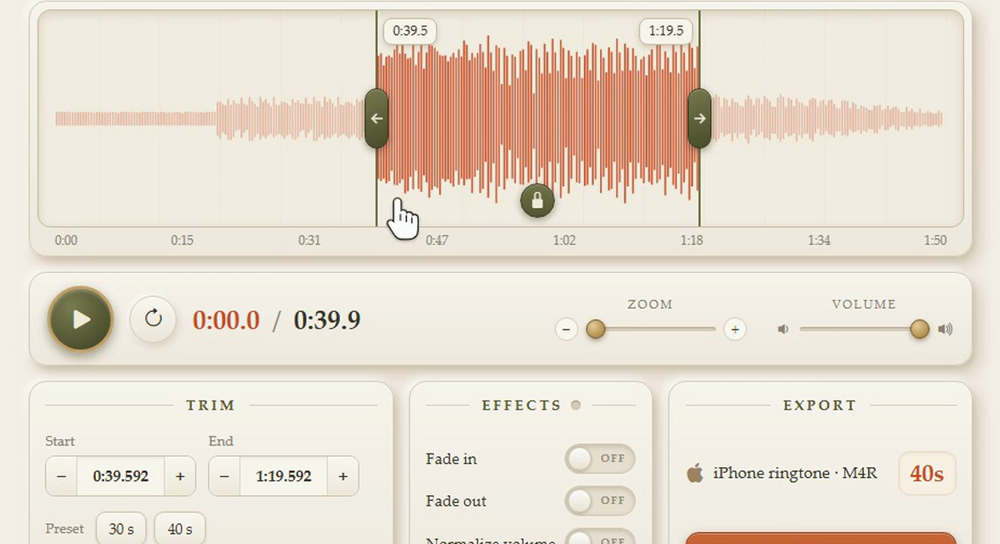

# Audio Cut Sheet

Keep a list of the parts you want before you edit a long recording. This small command-line tool checks the ranges and converts one cut sheet to tab-separated Audacity labels or WebVTT chapter cues. It leaves the recording itself alone.

## Try the example

```sh
node cuts.mjs example.json
node cuts.mjs example.json chapters
npm test
```

The example lists a short opening and the 40-second selection shown below. The output is in seconds with three decimal places.

```text
2.350	6.500	Opening
39.592	79.592	Chorus
```

Set the original duration and give each cut a start, end, and label. Enter times as `M:SS.mmm`, keep the ranges in playback order, and use the original file's timeline. Gaps are fine. To use the labels as a text file, redirect the first command's output to a file and import it as labels in your editor.

## Choose the next step

| Task | Tool |
| --- | --- |
| Keep just the range in the cut sheet | [MP3 Cutter](https://toolster.net/mp3_cutter) |
| Change the format of a finished file | [Audio Converter](https://toolster.net/audio_converter) |
| Export a clip as M4R for an iPhone | [iPhone Ringtone Creator](https://toolster.net/iphone_ringtone_maker) |
| Turn a recording into a transcript or subtitles | [Audio to Text](https://toolster.net/audio_to_text) |
| Record, trim and export a voice note | [Voice Recorder](https://toolster.net/voice_recorder) |
| Record a quick note | [Online Dictaphone](https://toolster.net/dictaphone_online) |
| Compare two tones as a listening exercise | [Binaural Beats](https://toolster.net/binaural_beats) |
| Generate a reference tone | [Tone Generator](https://toolster.net/tone_generator) |

Try it here: [Audio tools](https://toolster.net/sound_tools). The screen below shows selecting a range in the ringtone editor, the same operation the cut sheet lets you plan ahead.



Quick tutorial: https://youtu.be/c8O9hEKyLEw

The helper script is MIT-licensed.
